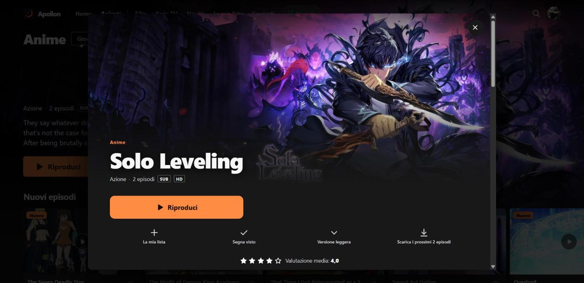
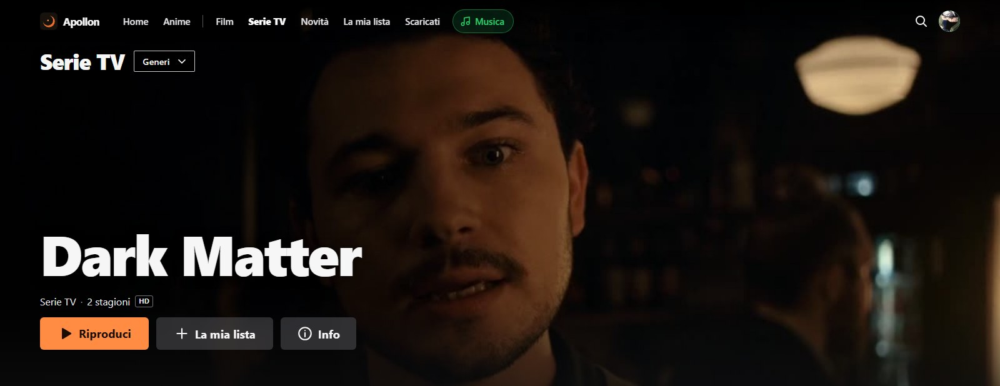
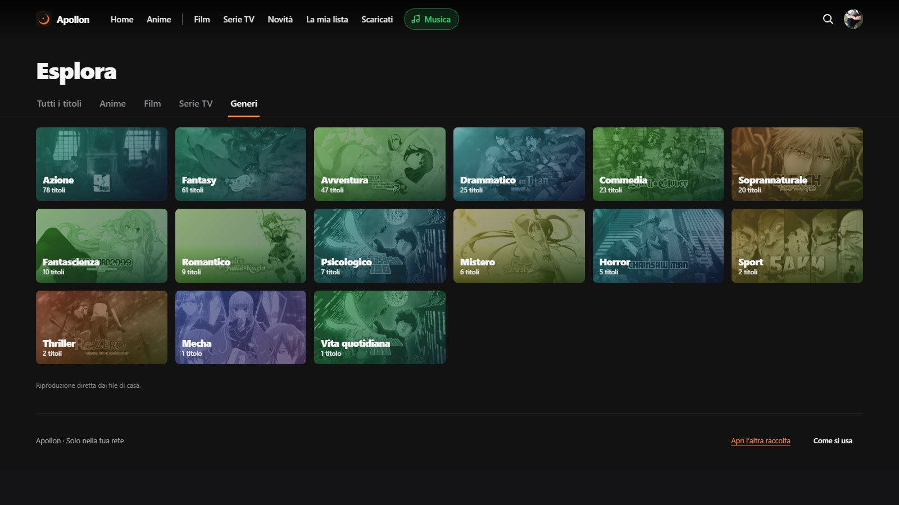
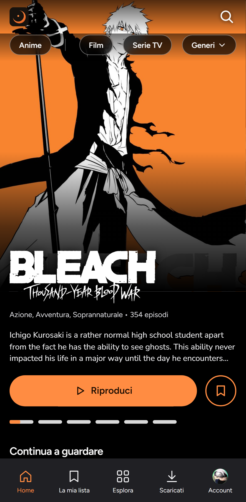
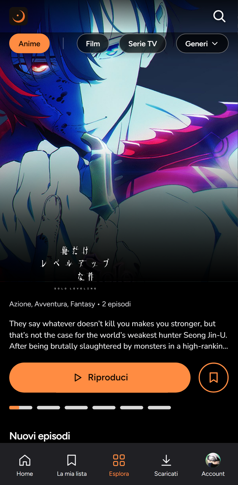
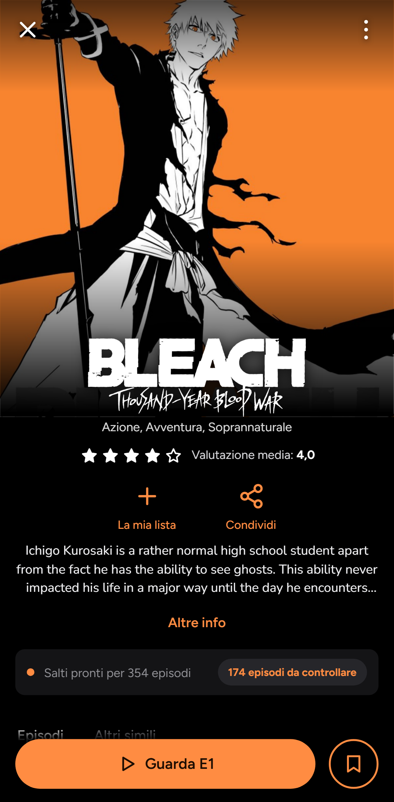

# Apollon

A self-hosted media server for the home network: films, TV series, anime and music, served from
**old Android phones running Node.js in Termux**, with no cloud service and no transcoding.

One phone holds the video library, another one holds the music (behind [Navidrome](https://www.navidrome.org/)).
Any device on the Wi-Fi opens Apollon in a browser: phone, PC, or the TV with its remote control.

The project was built by a small team of AI coding agents (Claude Code and Codex) under my direction:
I set goals, constraints and acceptance criteria, the agents wrote the code and the tests, and every
round was verified on the real devices before moving on.

> The interface and code comments are in Italian: the app is used by an Italian family.
> This repository contains the code only: no media, no covers, no personal data.

## Screenshots

Taken from the real app on the home network (the posters belong to their owners and are not part of this repository).


| Anime section | Title page |
|---|---|
|  |  |
| **TV series** | **Browse by genre** |
|  |  |

On a phone:

<p>
  
  
  
</p>

## What it does

**Video**
- Direct play of MP4, MKV, WebM, MOV, AVI, TS with HTTP Range requests: the file is streamed as it is,
  never re-encoded, so a 2014 phone can serve a 1080p film.
- Library built from folder names: `Show S01E02 Title`, `Show 1x02`, `Anime - 024`, season folders,
  specials. Posters, backdrops, genres, "continue watching", "my list", per-person progress.
- **Skip intro / recap / ending for anime, computed locally**: Chromaprint audio fingerprints are compared
  across episodes of the same season to find the shared opening and ending (15-120 s windows, offset
  compensation). No external skip database is required.
- External subtitles (SRT, ASS, VTT) converted on the fly to WebVTT.
- Trick-play thumbnails, offline download to the phone for the road.
- A second Apollon instance (e.g. on a desktop PC) can **lend its catalogue**: titles appear greyed out
  when that machine is off, and stream through the first server when it is on.

**TV mode**
- A dedicated 10-foot interface (`/tv`) driven by arrow keys, OK and Back: spatial focus navigation,
  rows, title pages, search with an on-screen keyboard, player with scrubbing and skip buttons.
- A legacy build (esbuild down-levelled to Chrome 79) for older smart-TV browsers.

**Music**
- A full music app on top of Navidrome / Subsonic: library, albums, artists, playlists, search,
  synced lyrics, queue, equalizer, gapless-style playback, offline cache with Range support.
- Listening recap, recommendations and mood/BPM catalogue from a local JSON file.
- Play on another device in the house (phone as remote for the PC or TV).

**Management**
- Rename, move, re-number, set covers, apply series metadata to a whole season atomically.
- Safe file operations: paths confined to the configured roots, no symlinks, no overwrites,
  removed files go to a hidden per-library recycle bin.

## How it is built

- **Server**: one Node.js process (`server.js` + `lib/`), no framework, no database. State is JSON on disk
  with atomic writes; the catalogue lives in memory and is rebuilt on scan.
- **Media work** is serialised: one ffmpeg/ffprobe process at a time, one thread, pauses between files.
  Built for phones with 2-3 GB of RAM.
- **Security model**: LAN only. Admin key for management, HttpOnly + SameSite=Strict session cookies,
  origin checks on state-changing requests, the Navidrome password is used once to obtain a token and
  never stored or sent to the browser.
- **Front end**: vanilla JavaScript modules, no build step for modern browsers; PWA manifest and service
  worker that caches the interface only, never media or API responses.
- **Tests**: 79 test files on `node --test` covering the server, the library parser, skip detection,
  music sessions, offline cache, TV navigation and the legacy build.

## Try it on a PC

Requirements: Node.js 22.7+, ffmpeg on the PATH.

```bash
npm run demo:crea   # generates a fake library: invented titles, drawn frames, silent audio
npm run demo        # starts the demo server on http://127.0.0.1:8871 (demo key: casa-demo)
npm test
```

The demo catalogue (films, series, music, lyrics) is entirely invented and generated by code.

## Install on an Android phone

See [GUIDA.md](GUIDA.md) (Italian). In short: copy the folder to the phone, run
`bash installa_mediateca.sh video` (or `music`) in Termux, then start it with
`bash ~/mediateca/avvia_mediateca.sh`. Configuration goes in `config.json`, starting from
[`config.example.json`](config.example.json).

Use it on a trusted home network only: it speaks plain HTTP and must not be exposed to the Internet.

## License

MIT
